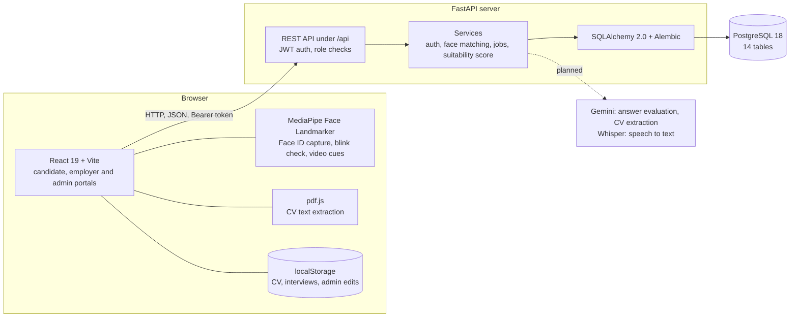

# Intervo Frontend

React app for **Intervo**, an AI-assisted interview coaching and candidate screening platform.

Final Year Project, Department of Software Engineering, University of Gujrat.

Intervo helps a candidate prepare for interviews: it reads their CV, shows the skill gap against a target role or job description, runs mock interviews in text, voice or video, and tracks weak skills over time. Employers post jobs and see applicants ranked by an explainable suitability score, using only the evidence each candidate agreed to share. An admin configures the roles, skills, questions and scoring rules.

This repository is the browser side, with three portals: candidate, employer and admin. The API and database are in **[Intervo-Backend](https://github.com/shuneenraza-bot/Intervo-Backend)**.

**Stack:** React 19 · Vite 8 · MediaPipe Tasks Vision (face landmarks) · pdf.js (CV text) · Web Speech API (voice) · plain CSS with light and dark themes · oxlint

## Contents

- [Features and objectives](#features-and-objectives)
- [Architecture](#architecture)
- [Setup on Windows](#setup-on-windows)
- [Demo accounts](#demo-accounts)
- [30% milestone](#30-milestone)
- [Known limitations](#known-limitations)
- [Connecting the backend](#connecting-the-backend)
- [Project layout](#project-layout)

The 7-minute evaluation walkthrough is in **[docs/DEMO.md](docs/DEMO.md)**.

## Features and objectives

Status at the 30% evaluation. "Where it runs" matters because part of the system still runs in the browser (see [Known limitations](#known-limitations)).

| # | Objective | Feature | Where it runs | Status |
|---|---|---|---|---|
| 1 | Secure, role-based access | Landing page, separate sign up, two-step sign in for candidate, employer and admin | Backend (JWT, argon2) | ✅ Done |
| 2 | Convenient sign-in | Face ID as an alternative to the password, with a blink liveness check | Capture in browser (MediaPipe), matching on backend | ✅ Done (prototype matcher) |
| 3 | CV analysis and skill gap | Upload PDF/DOCX/TXT or paste text; extract skills, education, experience and projects; weighted match against a role template or a pasted job description | Browser (pdf.js) | ✅ Done in browser · ⏳ server-side with Gemini |
| 4 | Mock interviews | Text, voice and video modes; questions chosen from weaknesses, CV gaps and the role's key skills; follow-up question when an answer is incomplete | Browser | ✅ Done in browser · ⏳ server-side |
| 5 | Answer evaluation and feedback | Per-criterion scores against the admin rubric, with a STAR check for behavioral questions | Browser, rule-based | ✅ Rule-based · ⏳ Gemini evaluator |
| 6 | Speech to text | Spoken answers become a live transcript | Browser (Web Speech API) | ✅ Browser · ⏳ Whisper |
| 7 | Presentation cues in video mode | Eye contact and expressiveness from face landmarks | Browser (MediaPipe) | ✅ Done |
| 8 | Progress tracking | Score trend, per-skill history and persistent weakness detection | Browser; session scores are also saved to PostgreSQL | ✅ Done |
| 9 | Job matching and applications | Candidates see match scores, apply with explicit consent and can withdraw | Backend | ✅ Done |
| 10 | Employer module | Job postings with weighted skills and success criteria; ranked candidates with an explainable suitability score; shortlist or decline | Backend | ✅ Done |
| 11 | Admin configuration | Domains and roles, skills, question templates, criteria and rules, users | Browser | ✅ Done in browser · ⏳ saved to backend |
| 12 | Privacy controls | Consent when applying, sharing switch, withdraw an application, delete Face ID, export data, delete history or account | Consent, sharing switch, withdraw and Face ID on backend; export and deletion in browser | ✅ Done · ⏳ deletion on the server |
| 13 | Deployment | Hosted demo | Not started | ⏳ Planned |

## Architecture



Solid lines exist today. The dotted line is planned work.

Every page calls one service layer, [src/api.js](src/api.js). For each module it either calls the backend or does the work in the browser, depending on `VITE_BACKEND_MODULES`. Moving a module to the server later means adding its name to that setting, with no change to the pages.

## Setup on Windows

You need:

- [Node.js](https://nodejs.org/) 20 or newer
- [Python 3.13](https://www.python.org/downloads/) and [PostgreSQL 18](https://www.postgresql.org/download/windows/) for the backend
- Git
- Chrome or Edge, with a webcam and microphone for Face ID and the voice and video interviews

### 1. Backend first

Follow **Setup on Windows** in the [Intervo-Backend README](https://github.com/shuneenraza-bot/Intervo-Backend#setup-on-windows). In short, after creating a database named `intervo` in pgAdmin:

```powershell
cd Intervo-Backend
py -3.13 -m venv .venv
.\.venv\Scripts\Activate.ps1
pip install -r requirements.txt
Copy-Item .env.example .env      # then set the Postgres password and JWT_SECRET in .env
alembic upgrade head
python -m scripts.seed
uvicorn app.main:app --reload --port 8000
```

### 2. Frontend

In a second PowerShell window, from this folder:

```powershell
npm install
Copy-Item .env.example .env
npm run dev          # http://localhost:5173
```

Open http://localhost:5173 in Chrome or Edge. Allow the camera and microphone when asked.

Other scripts: `npm run build` (production build into `dist/`), `npm run preview`, `npm run lint`.

### Running without the backend

Set `VITE_BACKEND_MODULES=` (empty) in `.env` and restart `npm run dev`. Everything then runs in the browser with `localStorage`, and no server or database is needed.

## Demo accounts

| Role | Email | Password |
|---|---|---|
| Candidate | ayesha@intervo.demo | Demo@1234 |
| Employer | hr@northstar.demo | Demo@1234 |
| Admin | admin@intervo.demo | Admin@1234 |

The sign-in page has a **Demo account** box that fills these in. The accounts are created by the backend's seed script.

## 30% milestone

### Done

- **Authentication.** Landing page, sign up, and two-step sign in with a password **or** Face ID, served by the real backend.
- **Employer module on the real backend.** Job postings, applications with consent, and candidates ranked by an explainable suitability score.
- **CV analyzer.** PDF, DOCX or pasted text; editable extracted skills; weighted skill gap against a role or a job description.
- **Mock interviews.** Text, voice and video; a session plan that explains why each question was picked; follow-up questions; presentation cues in video mode.
- **Dashboards.** Candidate overview and progress, employer hiring overview, admin configuration.
- **Privacy.** Consent when applying, a sharing switch that the server enforces, withdrawal, and deletion of Face ID. Data export and deletion of history or the account work on the browser copy.
- **Light and dark themes**, responsive layout.

### Next steps

1. Replace the rule-based answer scorer with the Gemini evaluator on the server.
2. Move CV parsing and job-description parsing to the server.
3. Send recorded audio to Whisper instead of using the browser's speech recognition.
4. Load and save interview sessions through the server so history follows the candidate across devices.
5. Save admin configuration changes to PostgreSQL.
6. Add server-side deletion of an account and its history.
7. Replace the Face ID matcher with a face-embedding model and add password reset.
8. Deploy, then run user testing with students.

## Known limitations

These are stated plainly so the evaluation reflects what is really built.

- **Answer scoring is rule-based.** Answers are scored in the browser from keywords, length and structure ([src/lib.js](src/lib.js)). It is consistent and explainable, but it does not understand meaning. Gemini will replace it. Scores are a practice aid, not ground truth.
- **Face matching is a prototype.** The browser measures ratios between face landmarks and the server compares them against a threshold. The blink check stops a printed photo, but this is not a trained face-recognition model and has not been measured for false accepts. The password always remains available.
- **CV parsing and interviews still run in the browser.** The full CV, answer text and session history are kept in this browser's `localStorage`. They do not follow the user to another browser or device, and clearing site data removes them. Only skills, a CV summary and per-answer scores (with the video cues) are copied to the database, for the employer ranking.
- **Deleting history or the account only clears the browser copy.** The account and the scores already copied to PostgreSQL stay there until a server-side delete endpoint is added. Turning off the sharing switch does hide the candidate from employers on the server straight away.
- **Admin edits are saved in the browser.** A change on the admin screens applies to the candidate pages in the same browser. It is not yet written to PostgreSQL, so it does not change the employer ranking, which uses the server's configuration.
- **Voice and video need Chrome or Edge.** The Web Speech API is not available in every browser.
- **CV parsing uses fixed rules.** Unusual layouts and scanned PDFs (images without selectable text) are not read. The extracted skills can be corrected by hand.
- **Presentation cues are observations, not judgments.** Eye contact and expressiveness are shown to the candidate only. The API never returns them to employers.
- **Not deployed.** The system runs on localhost.

## Connecting the backend

Two settings in `.env` control where each module runs. Restart `npm run dev` after changing them.

```
VITE_BACKEND_MODULES=auth,employer,candidate
VITE_API_URL=http://localhost:8000/api
```

| Setting | Meaning |
|---|---|
| `VITE_BACKEND_MODULES` | Comma-separated list of modules served by the backend. Empty = everything stays in the browser. |
| `VITE_API_URL` | Base URL of the backend, including `/api`, no trailing slash. |

| Module | What goes to the backend |
|---|---|
| `auth` | Account lookup, sign up, sign in (password or Face ID), Face ID enrol/delete, current user. The JWT is stored in the browser; a `401` signs the user out. |
| `employer` | Configuration (`GET /api/config`), job postings (list, create, edit, close/reopen), apply/withdraw, application status, candidate ranking. Also copies the candidate's skills, CV summary and session scores to the server. Needs `auth`. |
| `candidate` | CV upload and edits (`/cv`), job-description parsing and skill-gap match (`/jd/parse`, `/cv/match`), the mock interview (`/interviews`: server-chosen questions, Gemini or rule-based scoring, Whisper transcription of voice and video answers, follow-ups, finish), and progress. With it on, the profile and session copy described for `employer` is no longer sent. Needs `auth`. |

How the two sides fit together:

- After a backend sign-in or sign-up, the returned user is copied into the local store under the same id, so the candidate pages that still read the local store keep working.
- With `employer` on, the candidate's **Job Matches** page lists jobs from the backend and applies or withdraws through it, so employers see real applicants.
- The suitability score is calculated by the backend from its database. When a candidate finishes a session, edits their CV skills or applies, the frontend sends the skills, CV summary and per-answer scores. CV text, contact details and answer text are not sent.
- With `candidate` on, a slow or failed AI call shows a friendly message after about 30 seconds with a **Try again** button. If speech-to-text is unavailable on the server (503), the browser's live transcript is sent as text instead.
- If the backend is not running, the app shows "Can't reach the server — is the backend running?" instead of failing.

API docs are at http://localhost:8000/docs and the contract is in [API.md](API.md).

## Project layout

```
src/
  api.js          Service layer: routes each call to the backend or the local store, per module
  store.jsx       App-wide store backed by localStorage (also the cache for backend data)
  data.js         Demo seed and admin configuration
  lib.js          Scoring, matching and suitability logic used by the local modules
  cvParser.js     CV text extraction (PDF, DOCX, TXT) and CV / job-description parsing
  faceCues.js     MediaPipe face landmarks: Face ID geometry, blink, eye contact, expressiveness
  useSpeech.js    Speech to text with the Web Speech API
  Landing.jsx     Public landing page
  Auth.jsx        Sign in / sign up, Face ID
  Camera.jsx      Camera capture for Face ID enrolment and verification
  CandidateApp.jsx, EmployerApp.jsx, AdminApp.jsx   The three portals
  CVPage.jsx, InterviewPage.jsx, JobsPage.jsx, ProgressPage.jsx, ProfilePage.jsx   Candidate pages
docs/DEMO.md      Evaluation demo script
API.md            REST contract between this app and the backend
```
